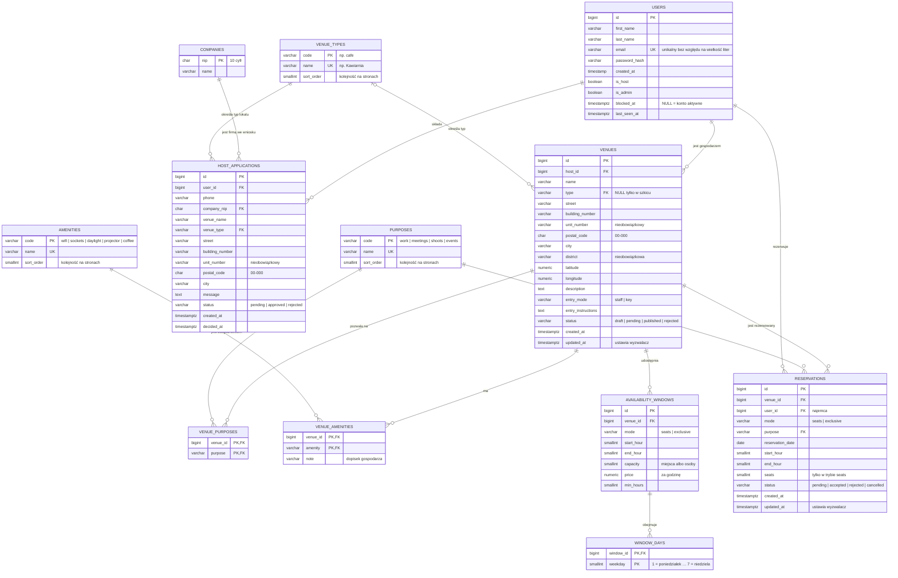

# PoGodzinach

**PoGodzinach** to aplikacja webowa do wynajmu lokali na godziny w czasie, gdy stoją puste albo są zamknięte – kawiarni, barów, restauracji i pracowni. Projekt na przedmiot *Wstęp do Projektowania Aplikacji Internetowych* (Politechnika Krakowska).

## Opis problemu

Wiele lokali przez dużą część dnia stoi pustych: bar rano, kawiarnia wieczorem, pracownia w dni wolne. Właściciel płaci za tę przestrzeń, ale w tych godzinach nic na niej nie zarabia. Jednocześnie wiele osób szuka miejsca na kilka godzin – do pracy zdalnej, na spotkanie lub szkolenie, sesję zdjęciową lub nagranie albo kameralne wydarzenie – a coworkingi i sale konferencyjne są drogie, mało klimatyczne albo wynajmowane na cały dzień.

PoGodzinach łączy obie strony: gospodarz udostępnia lokal w wybranych godzinach, a najemca rezerwuje go na tyle, ile potrzebuje.

## Role

| Rola | Możliwości |
|---|---|
| Najemca | Przegląda lokale w formie rolek i na mapie, filtruje je po celu, terminie i cenie, wysyła prośbę o rezerwację, po wizycie dodaje rolkę „Nagrane tutaj” |
| Gospodarz | Dodaje lokale, ustala okna dostępności, tryby i ceny, minimalny czas rezerwacji i sposób wejścia, akceptuje lub odrzuca prośby o rezerwację |
| Administrator | Moderuje rolki dodane przez gospodarzy i najemców |

Typ konta (najemca albo gospodarz) wybiera się przy rejestracji i jest zapisany w bazie. Przy logowaniu uprawnienia zawsze wynikają z roli zapisanej w bazie.

## Planowane funkcje

| Obszar | Opis |
|---|---|
| Odkrywanie | Pionowe rolki lokali zsynchronizowane z mapą, na której pinezki pokazują ceny; lokale z rolką są wyżej w wynikach |
| Tryby rezerwacji | Gospodarz ustala dla każdego okna dostępności tryb: „Na wyłączność” (cały lokal, stawka za godzinę) albo „Miejsca do pracy” (N miejsc, cena za miejsce za godzinę) |
| Cele | Praca, spotkania i szkolenia, sesje foto i wideo, kameralne wydarzenia – gospodarz zaznacza, na co pozwala, a najemca wybiera cel rezerwacji |
| Okna dostępności | Dni, godziny, tryb, liczba miejsc i cena; okna tego samego lokalu nie mogą się nakładać; minimalny czas rezerwacji ustala gospodarz (domyślnie 2 h) |
| Rezerwacja | Każda rezerwacja, także pojedynczego miejsca, jest prośbą, którą gospodarz akceptuje w ciągu 24 h; do tego czasu termin jest zablokowany, a nieprzyjęte prośby automatycznie anuluje zadanie CRON |
| Wejście do lokalu | Gospodarz wybiera dla lokalu: pracownik na miejscu albo przekazanie klucza z instrukcją widoczną po akceptacji |
| Interfejs | Wersje na telefon, tablet i komputer, tryb jasny i ciemny, język polski i angielski |

Płatności są symulowane – aplikacja wylicza kwotę rezerwacji, ale nie obsługuje płatności online.

## Prototyp

Klikalny prototyp w Figmie: [PoGodzinach – prototyp](https://www.figma.com/design/6hGVw8Jx7AhhGAp2oGK4uL) (podgląd interakcji: przycisk *Present*).

Pięć widoków, każdy w wersji na komputer (1440 px) i na telefon (390 px):

| Widok | Zawartość |
|---|---|
| Logowanie | E-mail i hasło, formularz z komunikatem błędu |
| Rejestracja | Imię i nazwisko, e-mail, hasło z powtórzeniem, zgoda na regulamin; konto startuje jako „Szukam przestrzeni”, rolę gospodarza nadaje administrator po wniosku |
| Odkrywaj | Rolki lokali i mapa z cenami, filtry celu, terminu, liczby osób i ceny |
| Lokal i rezerwacja | Opis lokalu, dozwolone cele, oferta, opinie i formularz prośby o rezerwację z podsumowaniem kwoty |
| Panel gospodarza | Statystyki, prośby o rezerwację do akceptacji, kalendarz tygodnia |
| Dodaj lokal | Formularz w krokach: dane, cele, zdjęcia, rolka, okna dostępności z walidacją nakładania się, wejście do lokalu |

## Stan implementacji

Gotowy jest szkielet MVC z laboratoriów oraz szablony HTML pięciu widoków z prototypu:

| Obszar | Co robi |
|---|---|
| Strona główna | Adres `/` przekierowuje do Odkrywaj |
| Logowanie | E-mail i hasło; walidacja i przekierowanie do Odkrywaj (bez sprawdzania hasła, które dojdzie w Laboratorium 9) |
| Rejestracja | Formularz z walidacją po stronie serwera jak w Laboratorium 9; po poprawnym wysłaniu przekierowanie na logowanie z komunikatem (zapis konta w bazie w Laboratorium 9) |
| Odkrywaj | Opublikowane lokale z bazy na mapie Mapbox (pinezki z ceną w wybranym trybie) obok kolumny kart; filtry celu (ze słownika celów) i trybu jako linki (`?purpose=…&mode=…`) oraz fraza z wyszukiwarki w nagłówku (nazwa, dzielnica, ulica, miasto) – filtrowanie robi zapytanie SQL; na telefonie przełącznik „Rolki / Mapa” |
| Moje rezerwacje | Rezerwacje bieżącego konta z bazy (nazwa lokalu z JOIN-a, termin, status: oczekuje, potwierdzona, odrzucona, anulowana); „Anuluj rezerwację” przy oczekującej lub potwierdzonej zmienia status na „anulowana”; cudzej rezerwacji nie da się anulować (404) |
| Lokal i rezerwacja | Opublikowany lokal z bazy: ścieżka, adres, ilustracja, gospodarz, opis, cele, oferta (wszystkie okna dostępności z dniami, godzinami i ceną), udogodnienia z dopiskiem gospodarza, sposób wejścia; panel rezerwacji jak w prototypie: tryb, cel, 7 kafelków dni i lista godzin z okna gospodarza, liczba miejsc z przyciskami −/+ (maksymalnie tyle, ile miejsc ma okno) i podsumowanie kwoty (`reservation.js`); poprawna prośba zapisuje się w bazie jako oczekująca na koncie bieżącego użytkownika; nieznane id albo lokal nieopublikowany dają 404 |
| Panel gospodarza | Tylko dla gospodarza – pozostali są przekierowywani do wniosku o rolę (rola z konta w bazie). Powitanie gospodarza i przycisk „Dodaj lokal”; oczekujące prośby w lokalach gospodarza (lista przewijana w karcie) z imieniem i nazwiskiem najemcy, terminem, czasem do wygaśnięcia (24 h od wysłania), celem, trybem i kwotą liczoną z ceny okna; Akceptuj / Odrzuć zmieniają status rezerwacji w bazie (komunikat po przekierowaniu); kafelki wszystkich lokali gospodarza ze statusem (szkic, czeka na weryfikację, opublikowany, odrzucony) i cenami trybów – do strony lokalu prowadzą tylko opublikowane |
| Zostań gospodarzem | Adres `/host/apply`: wniosek o rolę gospodarza w czterech kartach (dane kontaktowe z imieniem i nazwiskiem z konta, firma z NIP-em, pierwszy lokal, opis z licznikiem znaków), zgoda na regulamin i karta „Jak to działa”; walidacja w `HostApplicationForm`, po wysłaniu komunikat (zapis wniosku i zatwierdzanie przez administratora w kolejnych krokach Laboratorium 7) |
| Dodaj lokal | Formularz według prototypu: kroki po lewej (po wysłaniu „!” przy sekcji z błędem i „✓” przy pozostałych), nazwa, typ, adres z mapą Mapbox i pinezką do przeciągnięcia (współrzędne trafiają do formularza), opis z licznikiem znaków, karty celów, pola zdjęć i rolki, tabela okien dostępności z przyciskami „Dodaj okno” i usuwania, sposób wejścia, pasek z przyciskami; walidacja wykrywa nakładające się okna; szkic i wysłanie do weryfikacji |
| Panel administratora | Adres `/admin` (link i dostęp tylko dla administratora dojdą z rolami w Laboratorium 9): wnioski o rolę gospodarza z bazy (wnioskodawca z konta, firma po NIP-ie, lokal z typem i adresem, czas oczekiwania), lokale czekające na akceptację, tabela kont bez administratorów z wyszukiwarką (`?q=`) i filtrami grup (`?group=hosts`, `?group=blocked`) w SQL; decyzje zapisują się w bazie: zatwierdzenie wniosku (status wniosku i rola gospodarza w jednej transakcji) albo odrzucenie, opublikowanie albo odrzucenie lokalu, odebranie roli gospodarza, blokada i odblokowanie konta; ponowne wysłanie decyzji daje 404 albo 409 |
| Konto | Strony z menu konta: „Zmień hasło” (`/account/password`: aktualne hasło, nowe co najmniej 8 znaków i inne niż aktualne, zgodne powtórzenie) i „Usuń konto” (`/account/delete`: hasło i potwierdzenie) z walidacją i komunikatem po przekierowaniu; „Wyloguj się” wysyła `POST /logout` i wraca do logowania. Sprawdzenie hasła, zapis i sesja dojdą w Laboratorium 9 |
| Regulamin, Kontakt | Strony z linków w stopce i formularzach (`/terms`, `/contact`) z informacją na środku, że są w przygotowaniu |
| Obsługa błędów | Kontrolowane odpowiedzi 400, 404, 409, 422 i 500 (sekcja „Formularze i obsługa błędów”) |

Widoki to semantyczny HTML. W pełni ostylowane są widoki Logowanie, Rejestracja, Odkrywaj, Lokal i rezerwacja, Moje rezerwacje, Panel gospodarza, Zostań gospodarzem, Dodaj lokal, Panel administratora, Zmień hasło, Usuń konto, Regulamin i Kontakt, a także wspólny nagłówek z nawigacją i menu konta i stopka (opis w sekcji „Style CSS”), pozostałe widoki mają tylko style bazowe (kolory, fonty, linki, fokus). Na każdej stronie działa motyw jasny i ciemny (Laboratorium 5, sekcja „Motyw jasny i ciemny”). Wszystkie dane w widokach pochodzą z PostgreSQL (Laboratorium 7, sekcja „Baza danych”): lokale, okna, konta, rezerwacje, wnioski i nazwy ze słowników. Formularze są sprawdzane po stronie serwera. Zapisywane są rezerwacje i decyzje gospodarza oraz administratora; formularze „Dodaj lokal” i „Zostań gospodarzem” zapisze ostatni krok Laboratorium 7, a konta i hasła – Laboratorium 9. Do czasu logowania bieżącym użytkownikiem jest konto demo `piotr.nowak@example.com` (gospodarz). Pliki z formularza „Dodaj lokal” nie są jeszcze zapisywane (Laboratorium 13); przesuwanie pinezki po wpisaniu adresu (geokodowanie przez Fetch API) dojdzie w Laboratorium 11. Ochrona CSRF i sprawdzanie hasła dojdą w Laboratorium 9. Regulamin i Kontakt to strony „w trakcie przygotowania”. Przełącznika języka jeszcze nie ma.

## Tech stack

| Warstwa | Technologie |
|---|---|
| Backend | PHP 8.3 (PHP-FPM, Composer 2) |
| Baza danych | PostgreSQL 17, pgAdmin 4 |
| Serwer HTTP | Nginx |
| Poczta (dev) | Mailpit |
| Konteneryzacja | Docker Compose |

## Szybki start

Wymagania: Docker Desktop (z Docker Compose v2) i Git.

```bash
git clone https://github.com/JaneckiGit/wdpai-project.git
cd wdpai-project
cp .env.example .env   # następnie ustaw własne hasła w .env
docker compose up --build -d
docker compose exec php composer dump-autoload   # generuje vendor/autoload.php
```

Przy pierwszym starcie z pustą bazą kontener `db` wykonuje po kolei skrypty z `database/` – tworzy tabele i wgrywa dane demonstracyjne (sekcja „Baza danych”). Dane zostają potem w wolumenie `pg-data`, także po `docker compose down`. Skrypty startowe działają tylko na pustej bazie, więc gdy wolumen `pg-data` powstał wcześniej, nowe skrypty trzeba wykonać ręcznie (polecenie bierze nazwę użytkownika i bazy ze zmiennych kontenera `db`). Pętla poniżej dotyczy bazy, w której jest tylko tabela rezerwacji ze skryptu `01`; jeśli wolumen ma już tabele ze starszej wersji schematu, prościej odtworzyć bazę od zera (`docker compose down -v`, potem `docker compose up -d` – usuwa dane bazy):

```bash
for f in database/0[2-9]-*.sql database/1[0-9]-*.sql; do docker compose exec -T db sh -c 'psql -U "$POSTGRES_USER" -d "$POSTGRES_DB"' < "$f"; done
```

Baza utworzona przed krokiem „strony czytają z bazy” (skrypty 01–08) potrzebuje tylko dwóch nowych skryptów – kolejności słowników i najemcy rezerwacji; wcześniejsze rezerwacje dostają konto demo:

```bash
for f in database/09-*.sql database/10-*.sql; do docker compose exec -T db sh -c 'psql -v ON_ERROR_STOP=1 -U "$POSTGRES_USER" -d "$POSTGRES_DB"' < "$f"; done
```

Jeśli wolumen `pg-data` powstał wcześniej z innym hasłem, PostgreSQL pomija inicjalizację, a strony z rezerwacjami kończą się błędem 500 (`password authentication failed` w `docker compose logs php`) – wtedy `docker compose down -v` (usuwa dane bazy) i ponowny start, który wykona wszystkie skrypty od nowa.

Katalog `vendor/` nie jest w repozytorium, więc bez `composer dump-autoload` aplikacja kończy się błędem `Fatal error` (brak `vendor/autoload.php`).

Bez pliku `.env` zmienne `POSTGRES_*` i `PGADMIN_*` są puste (Docker Compose pokazuje tylko ostrzeżenia), więc baza i pgAdmin nie wystartują.

**Mapa (Mapbox)** – mapa w Odkrywaj potrzebuje publicznego tokenu Mapbox (`pk.…`). Wpisz go w `.env` jako `MAPBOX_TOKEN`, a w `MAPBOX_STYLE` adres stylu z Mapbox Studio (domyślnie `mapbox://styles/mapbox/light-v11`), potem `docker compose up -d php`. Token jest widoczny w przeglądarce, więc w panelu Mapbox ogranicz go do adresów aplikacji (*URL restrictions*). Bez tokenu w miejscu mapy jest komunikat.

## Usługi

| Usługa | Adres na komputerze | Adres w sieci Dockera | Opis |
|---|---|---|---|
| `server` (Nginx) | http://localhost:8080 | `server:80` | Aplikacja |
| `php` (PHP-FPM) | – | `php:9000` | Wykonuje kod PHP przekazany przez Nginx |
| `db` (PostgreSQL) | `localhost:5433` | `db:5432` | Baza danych |
| `pgadmin-wdpai` | http://localhost:5050 | – | Przeglądanie bazy |
| `mailpit` | http://localhost:8025 | SMTP: `mailpit:1025` | Skrzynka przechwytująca maile z aplikacji |

Porty po stronie komputera można zmienić w `.env` (`APP_PORT`, `POSTGRES_PORT`, `PGADMIN_PORT`, `MAILPIT_PORT`).

**pgAdmin** – zaloguj się danymi `PGADMIN_DEFAULT_EMAIL` / `PGADMIN_DEFAULT_PASSWORD` z `.env`, a następnie dodaj serwer: host `db`, port `5432` (port wewnątrz sieci Dockera, nie 5433), baza, użytkownik i hasło z `POSTGRES_*`.

**Skrypty startowe bazy** – pliki `*.sql` z `database/` są wykonywane po kolei (według numeru w nazwie) przy starcie kontenera z pustą bazą.

**Ollama** – usługa jest zakomentowana w `docker-compose.yaml` (patrz „Różnice względem konfiguracji z laboratorium”). Aby ją włączyć, usuń znaki `#` z bloku `ollama` i z wolumenu `ollama_data`, a następnie uruchom `docker compose up -d`. API będzie dostępne pod http://localhost:11434. Docker Desktop na macOS nie udostępnia kontenerom GPU, więc modele działają na CPU; na Linux/Windows z kartą NVIDIA można dodać `gpus: all`.

Przydatne polecenia:

| Polecenie | Zastosowanie |
|---|---|
| `docker compose ps` | Stan usług |
| `docker compose logs -f` | Logi wszystkich kontenerów na żywo |
| `docker compose exec php php -v` | Wersja PHP w kontenerze |
| `docker compose exec php php -m` | Lista modułów PHP |
| `docker compose exec php composer dump-autoload` | Generuje autoloader Composera – po sklonowaniu repo i po zmianie sekcji `autoload` w `composer.json` |
| `docker compose build --no-cache` | Przebudowa obrazów bez cache |
| `docker compose down` | Zatrzymanie i usunięcie kontenerów oraz sieci (dane bazy zostają w wolumenie `pg-data`; `down -v` usuwa także je) |
| `docker compose exec db sh -c 'psql -U "$POSTGRES_USER" -d "$POSTGRES_DB"'` | Konsola `psql` w bazie aplikacji, np. `\d reservations` albo `SELECT * FROM reservations;` |

## Architektura (MVC)

Aplikacja ma jeden punkt wejścia – `public/index.php` (Front Controller). Nginx przekazuje do niego każdy adres, który nie jest istniejącym plikiem (`try_files $uri $uri/ /index.php?$query_string`).

Przepływ żądania:

1. `public/index.php` rejestruje trasy w obiekcie `Routing` i przekazuje mu metodę HTTP oraz adres żądania.
2. `Routing::dispatch()` porównuje adres z listą tras (białą listą). Ścieżka trasy jest zamieniana na wyrażenie regularne, np. `/venues/{id}` → `~^/venues/(?P<id>\d+)$~`, więc `{id}` przyjmuje tylko cyfry.
3. Dla pierwszej pasującej trasy router tworzy obiekt kontrolera i wywołuje jego akcję, przekazując parametry z adresu (`/venues/2` → `VenueController::show(2)`).
4. Kontroler wywołuje odziedziczoną z `AppController` metodę `render()`, która udostępnia dane widokowi jako zmienne (`extract()`), wykonuje szablon z `public/views/` do bufora (`ob_start()` / `ob_get_clean()`) i wstawia wynik jako `$content` do wspólnego dokumentu `public/views/layout.html.php`. Layout zawiera `<head>`, arkusze stylów, przełącznik motywu i skrypty, więc widoki opisują już tylko treść strony.
5. Gdy żadna trasa nie pasuje, `index.php` ustawia status 404 i wyświetla widok `not-found`.

Klasy nie są ładowane ręcznie przez `require_once`. `index.php` wczytuje tylko `vendor/autoload.php` (a `src/Database.php` – plik ze stałymi `config.php`, który nie jest klasą), a autoloader Composera odnajduje plik klasy przy jej pierwszym użyciu, według reguł PSR-4 z `composer.json`:

| Namespace | Katalog | Przykład |
|---|---|---|
| `App\Controller\` | `src/controllers/` | `App\Controller\VenueController` → `src/controllers/VenueController.php` |
| `App\Form\` | `src/forms/` | `App\Form\LoginForm` → `src/forms/LoginForm.php` |
| `App\Model\` | `src/models/` | `App\Model\Reservation` → `src/models/Reservation.php` |
| `App\Repository\` | `src/repositories/` | `App\Repository\ReservationRepository` → `src/repositories/ReservationRepository.php` |
| `App\` | `src/` | `App\Routing` → `src/Routing.php`, `App\Database` → `src/Database.php` |

Bardziej szczegółowe reguły (np. `App\Controller\`, `App\Model\`) mają pierwszeństwo – katalogi zapisane małymi literami potrzebują ich, bo sama reguła `App\` szukałaby np. `src/Model/`. Nowa klasa jest odnajdywana bez zmian w `index.php`, jeśli jej namespace i nazwa pliku odpowiadają tym regułom.

| Element | Plik | Odpowiedzialność |
|---|---|---|
| Front Controller | `public/index.php` | Konfiguracja błędów i strefy czasowej, rejestracja tras, uruchomienie routera, obsługa 404 i 500 |
| Router | `src/Routing.php` | Dopasowanie metody i adresu do kontrolera i akcji |
| Kontroler bazowy | `src/controllers/AppController.php` | Wspólne renderowanie widoków i stron błędów, `isPost()`, `redirect()`, komunikaty statusu; jedno połączenie z bazą na żądanie (`database()`); każdy widok dostaje `$currentUser` – model `User` wczytany z bazy, do Laboratorium 9 konto demo `piotr.nowak@example.com` (nagłówek, menu konta, powitanie w panelu; `isHost()` decyduje, czy `/host` pokazuje panel, czy przekierowuje do wniosku); strona błędu serwera dostaje `null`, bo nie może zależeć od bazy, która mogła zawieść |
| Kontrolery | `src/controllers/*Controller.php` | Wybór widoku i danych dla danej trasy, koordynacja formularza i przekierowania |
| Formularze | `src/forms/*Form.php` | Dane wpisane przez użytkownika i reguły ich walidacji |
| Połączenie z bazą | `config.php`, `src/Database.php` | Dane połączenia (ze zmiennych środowiskowych) i utworzenie obiektu PDO z wyjątkami, wynikami jako tablice asocjacyjne i natywnymi prepared statements |
| Repozytoria | `src/repositories/*Repository.php` | Cały SQL danej tabeli i zamiana wierszy na modele |
| Modele | `src/models/*.php` | Dane jednego rekordu z typami; nie znają PDO ani SQL |
| Layout | `public/views/layout.html.php` | Wspólny dokument HTML: `<head>`, skrypt motywu, arkusze stylów (opcjonalny arkusz widoku ze zmiennej `$stylesheet`), przełącznik motywu, `theme.js` |
| Widoki | `public/views/*.html.php` | Semantyczny HTML z danymi od kontrolera |
| Wspólne fragmenty widoków | `public/views/partials/*.html.php` | Nagłówek z nawigacją i menu konta, lewa kolumna logowania i rejestracji, stopka, lista błędów formularza, komunikat statusu lista celów rezerwacji z etykietami i ikonami (`purposes.php`), typy lokalu (`venue-types.php`, klucze w `Form::VENUE_TYPES`) , skróty dni tygodnia (`day-names.php`) oraz funkcja inicjałów do kółek z osobą (`initials.php`), dołączane do widoków przez `require` |
| Autoloader | `composer.json`, `vendor/autoload.php` | Wczytywanie plików klas na podstawie namespace |

Nagłówek i stopka są wspólne dla wielu widoków, więc nie są kopiowane do każdego szablonu. Widok dołącza je instrukcją `<?php require __DIR__ . '/partials/header.html.php'; ?>`. Dołączony plik ma dostęp do tych samych zmiennych co widok, dlatego nagłówek korzysta ze zmiennej `$activeNav` przekazanej z kontrolera (albo pustej wartości domyślnej z `render()`) i oznacza bieżącą pozycję menu atrybutem `aria-current="page"`. Przełącznik motywu nie należy do nagłówka – layout dodaje go na każdej stronie jako pływający przycisk `.theme-toggle`.

## Baza danych

PostgreSQL 17 działa w usłudze `db`, a PHP łączy się z nią przez PDO (`pdo_pgsql`) pod nazwą hosta `db`. Schemat i dane demonstracyjne tworzą numerowane skrypty z `database/`, wykonywane po kolei przy pierwszym starcie z pustą bazą (jak migracje – każda zmiana schematu to kolejny plik):

| Skrypt | Zawartość |
|---|---|
| `01-create-reservations.sql` | Prośby o rezerwację (Laboratorium 7) |
| `02-create-updated-at-trigger.sql` | Funkcja `set_updated_at()` i wyzwalacz na `reservations` |
| `03-create-users.sql` | Konta – kolumny z Laboratorium 9 (z imieniem i nazwiskiem w osobnych kolumnach) oraz role i stan konta |
| `04-create-dictionaries.sql` | Słowniki: typy lokali, cele, udogodnienia (razem z ich wartościami) |
| `05-create-venues.sql` | Lokale, ich cele, udogodnienia, okna dostępności i dni okien |
| `06-create-host-applications.sql` | Firmy (po NIP-ie) i wnioski o rolę gospodarza |
| `07-link-reservations.sql` | Klucze obce rezerwacji do lokali i słownika celów |
| `08-demo-data.sql` | Dane demonstracyjne (10 kont, 5 lokali, okna, 3 firmy i 3 wnioski) |
| `09-add-dictionary-order.sql` | Kolejność pozycji słowników na stronach (`sort_order`) |
| `10-add-reservation-user.sql` | Najemca rezerwacji (`user_id`, klucz obcy do `users`); wcześniejsze rezerwacje dostają konto demo |



### Projekt bazy krok po kroku (przepis z wykładu)

1. **Zakres danych.** Baza przechowuje: konta (imię, nazwisko, e-mail, hash hasła, role najemcy, gospodarza i administratora, blokadę, ostatnią aktywność); lokale (nazwę, typ, adres, dzielnicę, położenie na mapie, opis, sposób wejścia, status weryfikacji, gospodarza); dozwolone cele i udogodnienia lokalu z dopiskiem gospodarza; okna dostępności (dni, godziny, tryb, liczbę miejsc albo osób, cenę za godzinę, minimalny czas); rezerwacje (lokal, tryb, cel, dzień, godziny, liczbę miejsc, status); wnioski o rolę gospodarza (telefon, firmę z NIP-em, pierwszy lokal, opis, status, datę decyzji).
2. **Grupowanie obiektów.** Każdy obiekt ma własną tabelę: `users`, `venues`, `availability_windows`, `reservations`, `host_applications`, `companies`, a stałe listy wartości – słowniki `venue_types`, `purposes`, `amenities`. Związki wiele-do-wielu (lokal – cel, lokal – udogodnienie) i dni okna to tabele łączące `venue_purposes`, `venue_amenities`, `window_days`.
3. **Klucz główny.** Każda tabela go ma: obiekty – liczbowe `id` nadawane przez bazę (`GENERATED ALWAYS AS IDENTITY`, w `users` `BIGSERIAL` z Laboratorium 9); słowniki – kod używany w aplikacji (`code`); firmy – NIP, który jednoznacznie je wskazuje; tabele łączące – klucz złożony z obu kolumn, np. `(venue_id, purpose)`, więc ten sam cel nie trafi do lokalu dwa razy. Dopisek udogodnienia (`note`) zależy od całego klucza `(venue_id, amenity)`, a nie od jego części.
4. **Dane atomowe.** Adres to osobne kolumny `street`, `building_number`, `unit_number`, `postal_code`, `city` (plus nieobowiązkowa `district`), imię i nazwisko to `first_name` i `last_name` (w instrukcji Laboratorium 9 jest jedna kolumna `name`), a dni okna, cele i udogodnienia są osobnymi wierszami zamiast listy w jednej kolumnie.
5. **Zależności przechodnie.** Nazwa firmy zależy od NIP-u, a nie od wniosku, więc jest w tabeli `companies`, a wniosek wskazuje firmę kolumną `company_nip`. Imię i nazwisko wnioskodawcy oraz gospodarza lokalu są tylko w `users` (wniosek i lokal przechowują `user_id` / `host_id`). Nazwy typów, celów i udogodnień są w słownikach, a ceny w oknach dostępności, bo gospodarz może mieć kilka okien w jednym trybie z różnymi cenami. Kwoty rezerwacji nie są zapisywane – wynikają z godzin, liczby miejsc i ceny okna.
6. **Relacje między tabelami.** Kolumny wskazujące na inne tabele mają klucze obce z przemyślanym zachowaniem:
   - `ON DELETE CASCADE` – dane, które bez rodzica nie mają sensu: usunięcie konta usuwa jego lokale, wnioski (strona „Usuń konto” to zapowiada) i – przez lokale – ich cele, udogodnienia, okna, dni okien i rezerwacje;
   - `ON DELETE RESTRICT` – słowniki i firmy: nie da się usunąć typu, celu, udogodnienia ani firmy, na które wskazuje jakiś wiersz;
   - `ON UPDATE CASCADE` – przy słownikach i firmach: zmiana kodu albo poprawiony NIP przechodzą do wszystkich wierszy, które na nie wskazują. Przy liczbowych `id` `ON UPDATE` zostaje domyślne, bo identyfikatory nadaje baza i się nie zmieniają.

   `reservations` z Laboratorium 7 dostaje klucze obce do `venues` i `purposes` osobnym skryptem `07`, bo powstała przed tymi tabelami, a klucz do najemcy (`user_id`, `ON DELETE CASCADE`) – skryptem `10`, razem z kodem, który zapisuje rezerwację na konto.

**Ograniczenia.** `CHECK` pilnują wartości, którymi steruje kod (tryby, statusy, dni 1–7, godziny, dodatnie ceny i liczby miejsc, kod pocztowy `00-000`, NIP z 10 cyfr, minimalny czas nie dłuższy niż okno) – np. `INSERT` ze statusem `'expired'` baza odrzuca błędem `reservations_status_check`, a cel spoza słownika – błędem klucza obcego `reservations_purpose_fkey`. `venues_complete_check` pozwala zapisać szkic z samą nazwą, ale lokal wysłany do weryfikacji musi mieć typ, adres, położenie i opis. Unikalny indeks `users_email_unique` (z Laboratorium 9) blokuje dwa konta z tym samym e-mailem niezależnie od wielkości liter, a częściowy indeks `host_applications_one_pending` – drugi oczekujący wniosek tej samej osoby. Indeksy na `status` i kluczach obcych przyspieszają filtry list i złączenia (np. oczekujące prośby, lokale do akceptacji).

**Wyzwalacz.** `set_updated_at()` ustawia `updated_at` przy każdym `UPDATE` tabel `reservations` i `venues`, także wtedy, gdy wiersz zmienia ktoś poza aplikacją (np. w pgAdmin albo `psql`) albo zapytanie zapomni o tej kolumnie. `ReservationRepository::update()` nadal ustawia `updated_at = CURRENT_TIMESTAMP` jak `ProjectRepository` z instrukcji Laboratorium 7 – wyzwalacz daje ten sam wynik, więc te dwa mechanizmy się nie gryzą.

**Dane demonstracyjne.** `08-demo-data.sql` tworzy fikcyjne konta, trzy opublikowane lokale (id 1–3, te same co w dotychczasowych adresach), dwa lokale czekające na akceptację, ich okna dostępności, trzy firmy i trzy wnioski o rolę gospodarza. Wartości słowników są w `04-create-dictionaries.sql`, bo aplikacja potrzebuje ich także bez danych demo. Wszystkie konta demo mają hasło `Demo1234` (w bazie tylko hash z `password_hash()`; logowanie dojdzie w Laboratorium 9):

| Konto | Rola |
|---|---|
| `admin@example.com` | Administrator |
| `piotr.nowak@example.com` | Gospodarz: Bar Lampion, Kawiarnia Ziarno, Piwnica Lampion (czeka na akceptację) |
| `tomasz.wrona@example.com` | Gospodarz: Kawiarnia Pod Zegarem |
| `marta.zielinska@example.com` | Najemca |
| `anna.kowalska@example.com` | Najemca z oczekującym wnioskiem o rolę gospodarza |
| `adam.nowicki@example.com` | Konto zablokowane |

**Transakcja.** Zatwierdzenie wniosku o rolę gospodarza zmienia dwie tabele: status wniosku (`host_applications`) i rolę konta (`users.is_host`). `HostApplicationRepository::approve()` wykonuje oba `UPDATE` między `beginTransaction()` a `commit()`; gdy drugi się nie uda, `rollBack()` cofa pierwszy, więc nie powstanie zatwierdzony wniosek bez roli gospodarza (sprawdzone wyzwalaczem, który na chwilę blokował zmianę konta – wniosek został „oczekujący”).

Wszystkie strony czytają dane z tabel z diagramu; zapis formularzy „Dodaj lokal” i „Zostań gospodarzem” to ostatni krok Laboratorium 7.

Statusy zmieniają akcje aplikacji:

| Akcja | Trasa | Status |
|---|---|---|
| Najemca wysyła prośbę ze strony lokalu | `POST /venues/{id}/reservations` | nowa rezerwacja `pending` |
| Gospodarz akceptuje albo odrzuca prośbę w swoim lokalu | `POST /host/requests/{id}` | `pending` → `accepted` / `rejected` |
| Najemca anuluje rezerwację | `POST /reservations/{id}/cancel` | `pending` / `accepted` → `cancelled` |

Przepływ od żądania do danych: przeglądarka → `public/index.php` i router → kontroler → repozytorium → PDO → PostgreSQL → wiersz tablicy (`FETCH_ASSOC`) → model → kontroler i widok, który korzysta z getterów modelu. Repozytoria i modele:

| Repozytorium | Model | Zapytania |
|---|---|---|
| `VenueRepository` | `Venue`, `AvailabilityWindow` | lokale z gospodarzem (`JOIN users`) i kodami celów (`string_agg`), okna z dniami, udogodnienia z dopiskiem; filtry Odkrywaj (`EXISTS`, `ILIKE`); lokale gospodarza i lokale w danym statusie; zmiana statusu |
| `ReservationRepository` | `Reservation` | CRUD z Laboratorium 7 z nazwą lokalu i najemcy (`JOIN venues`, `JOIN users`); rezerwacje konta; oczekujące prośby w lokalach gospodarza |
| `UserRepository` | `User` | konto po e-mailu (bez wielkości liter), tabela kont w panelu administratora z filtrami, zmiana roli i blokady |
| `HostApplicationRepository` | `HostApplication` | oczekujące wnioski z kontem i firmą (`JOIN users`, `JOIN companies`), decyzje (zatwierdzenie w transakcji) |
| `DictionaryRepository` | – | słowniki jako tablice kod => nazwa w kolejności `sort_order` (`FETCH_KEY_PAIR`) |

Kontroler tworzy repozytoria w konstruktorze ze wspólnym połączeniem z `AppController::database()` (jedno `new Database()` na żądanie); repozytorium wykonuje SQL wyłącznie przez `prepare()` i `execute()` z parametrami (`query()` tylko dla stałego zapytania bez danych z zewnątrz), więc dane użytkownika nie stają się częścią składni zapytania. Błąd połączenia kończy się stroną 500, a szczegóły trafiają do logu.

## Routing

| Metoda | Adres | Kontroler i akcja | Widok |
|---|---|---|---|
| GET | `/` | `DefaultController::index` | przekierowanie do `/venues` |
| GET | `/terms` | `DefaultController::terms` | `in-progress` (Regulamin – w przygotowaniu) |
| GET | `/contact` | `DefaultController::contact` | `in-progress` (Kontakt – w przygotowaniu) |
| GET, POST | `/account/password` | `AccountController::password` | `account-password` (Zmień hasło) |
| GET, POST | `/account/delete` | `AccountController::delete` | `account-delete` (Usuń konto) |
| GET, POST | `/login` | `SecurityController::login` | `login` |
| GET, POST | `/register` | `SecurityController::register` | `register` |
| POST | `/logout` | `SecurityController::logout` | przekierowanie do `/login` |
| GET | `/venues` | `VenueController::index` | `venues` (Odkrywaj) |
| GET | `/venues/{id}` (`id` – tylko cyfry) | `VenueController::show` | `venue` (Lokal i rezerwacja) |
| POST | `/venues/{id}/reservations` | `VenueController::requestReservation` | przekierowanie albo `venue` z błędami |
| GET | `/reservations` | `ReservationController::index` | `reservations` (Moje rezerwacje) |
| GET | `/admin` | `AdminController::dashboard` | `admin` (Panel administratora) |
| POST | `/admin/applications/{id}` | `AdminController::decideApplication` | przekierowanie albo `error` (400, 404) |
| POST | `/admin/venues/{id}` | `AdminController::decideVenue` | przekierowanie albo `error` (400, 404) |
| POST | `/admin/users/{id}` | `AdminController::updateUser` | przekierowanie albo `error` (400, 404, 409) |
| POST | `/reservations/{id}/cancel` | `ReservationController::cancel` | przekierowanie albo `error` (404, 409) |
| GET | `/host` | `HostController::dashboard` | `host-dashboard` (Panel gospodarza) |
| GET, POST | `/host/apply` | `HostController::apply` | `host-application` (Zostań gospodarzem) |
| GET, POST | `/host/venues/new` | `HostController::addVenue` | `add-venue` (Dodaj lokal) |
| POST | `/host/requests/{id}` | `HostController::decideRequest` | przekierowanie albo `error` (400, 404) |
| – | każdy inny adres lub metoda | `DefaultController::notFound` (status 404) | `not-found` |

Parametry zapytania (query parameters):

| Adres | Parametry | Znaczenie |
|---|---|---|
| `/venues` | `q`, `purpose`, `mode` | Wyszukiwanie i filtry, np. `/venues?q=Kazimierz&purpose=meetings`; niepoprawne wartości dają status 400 i listę błędów |
| `/admin` | `q`, `group` | Wyszukiwanie użytkowników po imieniu lub e-mailu i grupa (`all`, `hosts`, `blocked`); nieznana grupa daje status 400 |
| `/host`, `/host/apply`, `/venues/{id}`, `/reservations`, `/admin`, `/account/password`, `/login` | `status` | Komunikat po przekierowaniu, wybierany z listy dozwolonych; nieznana wartość jest ignorowana |

Sprawdzenie z terminala:

```bash
curl -i http://localhost:8080/venues/2
```

```bash
curl -i http://localhost:8080/venues/abc
```

```bash
curl -i "http://localhost:8080/venues?purpose=zzz"
```

Drugi adres zwraca 404, bo `{id}` przyjmuje tylko cyfry. Pierwszy wyświetla widok lokalu, a formularz rezerwacji wysyła dane na `/venues/2/reservations`. Trzeci zwraca 400, bo cel spoza listy jest błędem. Lokal o id, którego nie ma w bazie (np. `/venues/99`), albo lokal jeszcze nieopublikowany (np. `/venues/4` z danych demo – czeka na akceptację) też zwraca 404.

## Formularze i obsługa błędów

Przepływ formularza (wzorzec Post/Redirect/Get):

1. Router kieruje `POST` do akcji kontrolera, a ta tworzy obiekt formularza z danych `$_POST`.
2. `isValid()` uruchamia reguły z klasy formularza.
3. Dane poprawne: `redirect()` odsyła status 303 na inny adres, więc odświeżenie strony nie wyśle formularza drugi raz. Komunikat pokazuje parametr `status`.
4. Dane błędne: status 422 i ten sam widok z listą błędów, czerwonymi ramkami pól (`aria-invalid`) i zachowanymi wartościami. Hasło nigdy nie wraca do formularza.

| Klasa | Formularz | Najważniejsze reguły |
|---|---|---|
| `Form` | Klasa abstrakcyjna | Wspólne reguły: poprawny e-mail, nowe hasło (co najmniej 8 znaków i zgodne powtórzenie – rejestracja i zmiana hasła), wybór z listy, długość tekstu, dodatnia liczba, zakres pełnych godzin, poprawna data; odporność na tablice zamiast tekstu (`email[]=x`) |
| `LoginForm` | Logowanie | Poprawny e-mail, niepuste hasło |
| `RegisterForm` | Rejestracja | Niepuste imię i nazwisko, poprawny e-mail, hasło co najmniej 8 znaków, zgodne powtórzenie hasła, zaakceptowany regulamin |
| `ReservationForm` | Prośba o rezerwację | Tryb, w którym gospodarz ma okno, cel dozwolony w lokalu, dzień z najbliższych 7 dni i z dni okna, co najmniej 2 godziny z okna idące jedna po drugiej, 1–4 miejsca w trybie „Miejsca do pracy” |
| `HostApplicationForm` | Zostań gospodarzem | Imię, nazwisko, nazwa firmy, nazwa i adres lokalu, opis (niepuste, z limitem długości), telefon z co najmniej 9 cyframi, NIP z 10 cyfr, typ lokalu z listy, zaakceptowany regulamin |
| `VenueForm` | Dodaj lokal | Szkic wymaga tylko nazwy. Wysłanie do weryfikacji: typ, adres, współrzędne pinezki (liczby w zakresie szerokości i długości geograficznej), opis, co najmniej jeden cel, poprawne okna, instrukcja wejścia przy przekazaniu klucza |
| `AvailabilityWindowForm` | Okno dostępności | Dni, godziny, tryb, liczba miejsc, cena, minimum godzin nie dłuższe niż okno; `overlaps()` wykrywa okna o wspólnym dniu i przecinających się godzinach |
| `VenueFilterForm` | Filtry w Odkrywaj (GET) | Fraza do 100 znaków, cel i tryb z listy (domyślnie praca i miejsce do pracy) |
| `UserFilterForm` | Filtry użytkowników w panelu administratora (GET) | Fraza do 100 znaków, grupa z listy (domyślnie wszyscy) |
| `ChangePasswordForm` | Zmień hasło | Niepuste aktualne hasło, nowe hasło co najmniej 8 znaków i inne niż aktualne, zgodne powtórzenie |
| `DeleteAccountForm` | Usuń konto | Niepuste hasło, zaznaczone potwierdzenie |

| Status | Kiedy |
|---|---|
| 303 | Poprawny formularz – przekierowanie (`redirect()`) |
| 400 | Nieznana decyzja gospodarza lub administratora, nieznana akcja na koncie użytkownika, niepoprawne filtry w adresie |
| 404 | Nieznany adres lub metoda, identyfikator niebędący liczbą, nieistniejący albo nieopublikowany lokal, nieistniejąca lub cudza rezerwacja, prośba z cudzego lokalu albo już z decyzją, wniosek nieistniejący albo już z decyzją, lokal, który nie czeka na akceptację, nieistniejący użytkownik albo administrator |
| 409 | Anulowanie rezerwacji odrzuconej albo już anulowanej; blokada zablokowanego, odblokowanie aktywnego albo odebranie roli komuś, kto nie jest gospodarzem |
| 422 | Błędne dane w formularzu `POST` |
| 500 | Nieoczekiwany błąd, np. brak połączenia z bazą – strona bez szczegółów technicznych |

Błędy wykonania: `public/index.php` wyłącza `display_errors` i zamienia ostrzeżenia PHP na wyjątki, a blok `try/catch` wokół routera zapisuje wyjątek w logu (`docker compose logs php`), czyści bufor z niedokończonym widokiem i pokazuje stronę 500.

Strony 404 i błędów (`not-found`, `error`) mają wspólny nagłówek z nawigacją i stopkę, więc z każdej z nich można przejść do innej części aplikacji. Kontroler nie musi przekazywać im `$activeNav` – `render()` podaje pustą wartość, gdy jej brakuje, i żadna zakładka nie jest wtedy oznaczona jako bieżąca.

Dane wyświetlane z powrotem w HTML przechodzą przez `htmlspecialchars()`, więc wpisany kod (np. `<script>`) jest pokazywany jako tekst.

## Style CSS

| Plik | Zawartość |
|---|---|
| `public/css/style.css` | Zmienne CSS (tokeny projektu w wariancie jasnym i ciemnym), `box-sizing`, typografia, linki, fokus oraz wspólne komponenty: logo, przycisk, pola formularza z podpowiedzią, pole wyboru (checkbox), pole opisu (textarea) z licznikiem znaków (`.field__count`), karty sekcji formularza z numerem i siatka pól (`.form-section`, `.form-grid`), niższe pola w formularzach aplikacji (`.app-form`), przycisk drugorzędny (`.button--secondary`) i przycisk akcji nieodwracalnej (`.button--danger`), ścieżka (`.breadcrumbs`), karta (`.card`), plakietka celu (`.chip`) i plakietka trybu lub statusu (`.badge`), kontener strony (`.page`, wąski `.page--narrow`) i strona z krótkim komunikatem – „w trakcie przygotowania”, 404 i błąd (`.message-page`), kolumna z odstępem (`.stack`), szary podpis (`.muted`), kwadrat z ikoną (`.icon-tile`) kółko z inicjałami (`.initials`), wybrany filtr (`.chip[aria-current]`), plakietki statusu (`.badge--success`, `--warning`, `--danger`, `--muted`), karta z listą i licznikiem (`.panel`, `.count`, `.list-item`), przyciski decyzji (`.actions`, do prawej `.actions--end`, `.button--outline`) i pole wyszukiwania (`.search`) używane w kilku widokach, pola liczb bez strzałek w formularzach aplikacji, nagłówek z nawigacją (na telefonie dolny pasek) i menu konta pod avatarem (atrybut `popover` – otwieranie i zamykanie bez JavaScriptu; „Wyloguj się” to przycisk formularza wyglądający jak link), stopka, przełącznik motywu, klasa `visually-hidden` |
| `public/css/login.css` | Układ widoków Logowanie i Rejestracja (dołączany przez layout, gdy kontroler przekaże `'stylesheet' => 'login'`) |
| `public/css/venues.css` | Układ widoku Odkrywaj: pasek celu i trybu, mapa, karty lokali, przełącznik „Rolki / Mapa” na telefonie |
| `public/css/venue.css` | Widok Lokal i rezerwacja według prototypu: rolka i „Nagrane tutaj”, karta gospodarza, cele, karty ofert z plakietkami, udogodnienia, wejście i panel rezerwacji: przełącznik trybu, kafelki dni i lista godzin (ukryte pola radio i checkbox, wybór wyróżnia `:has(:checked)`), licznik miejsc i podsumowanie; na telefonie jedna kolumna, od 1024 px panel obok treści (`position: sticky`), od 1280 px trzy kolumny |
| `public/css/add-venue.css` | Widok Dodaj lokal według prototypu: kroki ze stanami, karty sekcji z numerami, karty wyboru (`:has(:checked)`), pola plików w ramce, tabela okien z jednostkami pól (miejsc / osób zależnie od trybu, `zł/h`, `h`), pasek z przyciskami przyklejony od 768 px |
| `public/css/reservations.css` | Lista kart w Moich rezerwacjach i kolory statusów |
| `public/css/host.css` | Panel gospodarza: powitanie, dwie kolumny, przewijana lista próśb (od 1024 px z cienkim paskiem przewijania), karty lokali z miniaturami |
| `public/css/admin.css` | Panel administratora: szare pole z danymi wniosku, kafelki lokali do akceptacji, nagłówek tabeli z wyszukiwarką i filtrami, tabela użytkowników przewijana w poziomie na telefonie |
| `public/css/host-application.css` | Zostań gospodarzem: formularz w kartach sekcji obok karty „Jak to działa” (od 1024 px przyklejonej przy przewijaniu), pole e-maila tylko do odczytu |
| `public/js/theme.js` | Przełączanie i zapamiętywanie motywu |
| `public/js/map.js` | Mapa Mapbox: pinezki z ceną z atrybutu `data-venues`, wbudowane przyciski przybliżania i lokalizacji, wyróżnienie pinezki lokalu z karty widocznej w kolumnie (`IntersectionObserver`), przeliczenie rozmiaru po pokazaniu mapy na telefonie (`ResizeObserver`) |
| `public/js/reservation.js` | Panel rezerwacji: przy zmianie trybu pokazuje jego dni i godziny, a pola drugiego trybu wyłącza (`disabled`), więc formularz ich nie wysyła; zaznacza godziny między pierwszą a ostatnią wybraną, obsługuje −/+ i liczy kwotę. Serwer i tak sprawdza dane w `ReservationForm` |
| `public/js/add-venue.js` | Dodaj lokal: „Dodaj okno” (kopia pierwszego wiersza) i usuwanie okien z numerowaniem pól `windows[0]`, `windows[1]`…, mapa Mapbox z pinezką do przeciągnięcia, która zapisuje współrzędne w ukrytych polach |
| `public/js/char-count.js` | Licznik znaków pod polem z atrybutem `data-counter` (opis w Dodaj lokal i we wniosku o rolę gospodarza) |
| `public/images/login-hero.svg` | Ilustracja z prototypu w lewej kolumnie logowania; na razie także obraz każdego lokalu w Odkrywaj i avatar (twarz Anny wycięta przez `background-position`) |

Kolory, fonty, odstępy i zaokrąglenia są zapisane raz w `:root` jako zmienne nazwane według roli (np. `--color-primary`, `--color-muted`, `--space-2`, `--radius`), a reguły odwołują się do nich przez `var()`. Wartości pochodzą z prototypu: kolor marki `#B4532A`, tekst `#1C1917`, tło `#F4EFE9`, nagłówki w kroju Newsreader, tekst w Inter (oba z Google Fonts).

Widoki Logowanie i Rejestracja mają wspólną lewą kolumnę z ilustracją (`partials/auth-hero.html.php`) i są zbudowane mobile first – reguły bez media query opisują telefon, a szersze ekrany je rozszerzają:

| Szerokość | Układ |
|---|---|
| poniżej 64rem (1024 px) | Jedna kolumna: ilustracja jako baner z hasłem, pod nią formularz |
| od 64rem (1024 px) | Dwie kolumny strony (Grid z `grid-template-areas`): ilustracja z hasłem, opisem i celami po lewej, formularz i stopka po prawej |

Stany interfejsu: `:hover` dla linków, przycisku i pól; `:focus-visible` z obrysem 3 px w kolorze marki dla linków, przycisków i pól. Pole regulaminu to systemowy checkbox w kolorze marki (`accent-color`).

Sprawdzone w przeglądarce na szerokościach 360, 768 i 1440 px – bez poziomego przewijania.

## Motyw jasny i ciemny

Motyw to dane: atrybut `data-theme="light"` albo `data-theme="dark"` na `<html>` wybiera zestaw wartości tych samych zmiennych CSS. Komponenty używają tylko ról (`var(--color-surface)`, `var(--color-text)` …), a blok `html[data-theme="dark"]` w `style.css` podmienia ich wartości. Nie ma osobnego arkusza dla ciemnego motywu.

Kolejność wyboru motywu:

1. zapisany wybór użytkownika – `localStorage`, klucz `theme`, wartość `light` albo `dark`;
2. jeśli zapisu nie ma – ustawienie systemu (`prefers-color-scheme`); strona reaguje też na jego zmianę w trakcie oglądania.

| Element | Plik | Działanie |
|---|---|---|
| Skrypt w `<head>` | `public/views/layout.html.php` | Ustawia `data-theme` przed pierwszym arkuszem stylów, więc strona nie miga jasnym motywem przed ciemnym (brak FOUC) |
| Przełącznik | `public/views/layout.html.php`, `.theme-toggle` w `style.css` | Element `<button>` obsługiwany myszą i klawiaturą (Tab, Enter, Spacja); `aria-label` i `aria-pressed` opisują stan, ikona (Font Awesome) pokazuje działanie: księżyc włącza ciemny, słońce jasny |
| Logika | `public/js/theme.js` | Przełącza motyw, zapisuje wybór, synchronizuje przycisk i podąża za systemem, dopóki nie ma zapisu |

Kolor marki, przyciski, logo i ilustracja logowania są takie same w obu motywach. Powrót do ustawienia systemowego (np. przy testach): w konsoli przeglądarki `localStorage.removeItem('theme'); location.reload();`.

Sprawdzone w przeglądarce: start w motywie systemowym bez zapisu, zapis po kliknięciu, zachowanie wyboru po przejściu na inną stronę i po odświeżeniu, obsługa klawiaturą, brak nadpisania zapisanego wyboru przez zmianę motywu systemu.

Kontrast par kolorów (WCAG 2.1, wymagane 4,5:1 dla tekstu i 3:1 dla obrysu fokusu i ramek pól):

| Para | Jasny | Ciemny |
|---|---|---|
| Tekst na tle | 15,3:1 | 16,2:1 |
| Tekst pomocniczy na tle | 6,7:1 | 8,6:1 |
| Tekst pomocniczy na karcie | 7,2:1 | 7,5:1 |
| Link na tle | 6,2:1 | 7,7:1 |
| Komunikat błędu na tle błędu | 5,7:1 | 8,3:1 |
| Obrys fokusu na tle | 4,4:1 | 7,7:1 |
| Ramka pola na tle | 3,3:1 | 5,0:1 |
| Biały tekst na przycisku | 5,0:1 | 5,0:1 |

## Konfiguracja PHP

Obraz PHP zawiera moduły `pdo_pgsql`, `pgsql`, `gd` (z JPEG), `zip`, `bcmath`, `opcache`, `xdebug` oraz Composer 2. Limity uploadu w PHP: `upload_max_filesize` i `post_max_size` = 512M, `max_file_uploads` = 20 (plik `conf.d/mealplanner.ini`).

**Xdebug (Laboratorium 6)** – debugowanie krok po kroku zamiast `var_dump()`. Ustawienia są w `docker/php/conf.d/xdebug.ini` (`mode=develop,debug`, `client_host=host.docker.internal`, `start_with_request=yes`), a `docker/php/conf.d/error_reporting.ini` ustawia `error_reporting=E_ALL`. Oba pliki są podpięte jako wolumeny usługi `php`, więc po ich zmianie wystarczy `docker compose up -d php`. Przy każdym żądaniu Xdebug łączy się z edytorem na porcie 9003:

- PhpStorm: *Settings → PHP → Debug* (port 9003), włącz nasłuchiwanie ikoną słuchawki na pasku narzędzi, a przy pierwszym połączeniu zmapuj katalog projektu na `/app`;
- VS Code: rozszerzenie *PHP Debug* i w `.vscode/launch.json` konfiguracja `{ "name": "Xdebug", "type": "php", "request": "launch", "port": 9003, "pathMappings": { "/app": "${workspaceFolder}" } }`.

Ustaw breakpoint i odśwież stronę – edytor zatrzyma wykonanie w tym miejscu. Gdy edytor nie nasłuchuje, strona działa normalnie, a w `docker compose logs php` przy każdym żądaniu pojawia się wpis `Could not connect to debugging client`. `docker compose exec php php -v` pokazuje `with Xdebug v3…`, a `xdebug_info();` w kodzie wyświetla diagnostykę połączenia.

## Różnice względem konfiguracji z laboratorium

Pliki `docker-compose.yaml`, `docker/php/Dockerfile` i `docker/nginx/*` są zgodne z instrukcjami z laboratorium, z trzema wyjątkami:

- z usługi `ollama` usunięto `gpus: all`, bo Docker Desktop na macOS zwraca błąd `could not select device driver "" with capabilities: [[gpu]]` i kontener nie startuje;
- usługa `php` dostaje `MAPBOX_TOKEN` i `MAPBOX_STYLE` z `.env` (`environment`, jak `db` dostaje `POSTGRES_*`); PHP odczytuje je przez `getenv()`, więc token nie trafia do repozytorium;
- usługa `ollama` i wolumen `ollama_data` są zakomentowane – uruchamianie modeli językowych w kontenerze (na CPU) wymaga kilku GB pamięci RAM, a Docker ma na tym komputerze do dyspozycji 7,7 GB. Usługa została dodana i uruchomiona zgodnie z zadaniem, a następnie wyłączona.

`docker/db/Dockerfile` (`FROM postgres:17-alpine`) jest wymagany przez `docker-compose.yaml`, ale instrukcja nie podaje jego treści.

Xdebug z Laboratorium 6 jest dodany 1:1 według artykułu podlinkowanego w materiałach: `pecl install xdebug` i `docker-php-ext-enable xdebug` w `docker/php/Dockerfile`, pliki `xdebug.ini` i `error_reporting.ini` z artykułu w `docker/php/conf.d/` i te same dwa wolumeny w usłudze `php`. Różnice wynikają z obrazu projektu: artykuł używa `php:7.4-fpm` (Debian), a projekt `php:8.3-fpm-alpine`, w którym `pecl` potrzebuje narzędzi kompilacji (`$PHPIZE_DEPS`, `linux-headers`) – są instalowane tylko na czas instalacji i usuwane w tym samym kroku `RUN`. Kod jest w kontenerze w `/app` zamiast `/var/www/html`, dlatego edytor potrzebuje mapowania ścieżek. Artykuł opisuje PhpStorm; konfiguracja VS Code jest w sekcji „Konfiguracja PHP”, bo katalog `.vscode/` jest w `.gitignore`.

Szkielet MVC (`src/Routing.php`, `src/controllers/`, `public/views/`, `public/index.php`) i `composer.json` są zgodne 1:1 z instrukcjami z Laboratorium 2, z wyjątkiem zmian wymaganych przez wspólny layout z Laboratorium 5 (opisanych niżej). Composer jest w obrazie PHP od Laboratorium 1, a `.gitignore` już zawierał wpis `vendor/`, który obejmuje `/vendor/` z instrukcji.

Kontrolery `SecurityController`, `VenueController` i `HostController`, widoki PoGodzinach i katalog `public/views/partials/` powstały w ramach zadań 2 i 3 z Laboratorium 2 (własny kontroler, trasy, szablony widoków z prototypu). Pliki z instrukcji nie zostały zmienione – w `public/index.php` doszły tylko nowe trasy i instrukcje `use`. Wyjątkiem jest widok `not-found.html.php`: zadanie 4 z Laboratorium 4 wymaga nawigacji dołączanej do każdego widoku, więc dostał wspólny nagłówek, stopkę i klasy układu strony z komunikatem; jego treść (nagłówek „404”, zdanie i link na stronę główną) jest taka sama jak w instrukcji. Nazwy `SecurityController` i `login.html.php` są takie same jak w Laboratorium 9, w którym powstaje logowanie.

Style z Laboratorium 3 korzystają z przykładów z instrukcji (zmienne w `:root`, `box-sizing`, typografia, linki, `:focus-visible`, Flexbox i Grid, `min()`, `clamp()`, media query `min-width: 48rem`) z wartościami z prototypu. Świadome różnice:

- obrys fokusu ma pełny kolor marki zamiast `color-mix(in srgb, var(--color-brand) 45%, white)` – jaśniejszy kolor miał na kremowym tle kontrast tylko 1,7:1, a pełny ma 4,4:1;
- linki po najechaniu zmieniają kolor na ciemniejszy (jak w prototypie) zamiast `opacity: 0.8`;
- ramki pól formularza są ciemniejsze niż w prototypie (`#8A837C`), żeby pole było widoczne na tle z kontrastem co najmniej 3:1;
- oprócz breakpointu 48rem jest drugi, 64rem, bo dwie kolumny logowania potrzebują więcej miejsca.

Motyw z Laboratorium 5 korzysta 1:1 z kodu instrukcji: skrypt w `<head>`, znaczniki i style przełącznika `.theme-toggle`, `public/js/theme.js` oraz nazwy tokenów (`--color-bg`, `--color-primary`, `--color-focus`, `--shadow-soft` … – tokeny z Laboratorium 3 zostały do nich przemianowane). Świadome różnice:

- instrukcja zakłada wspólny `public/views/layout.html.php` z `<?= $content ?>`, którego projekt wcześniej nie miał – powstał, a `AppController::render()` buforuje widok i dołącza layout; widoki z Laboratorium 2 straciły przez to własne `<!doctype>`, `<head>` i `<body>` (treść bez zmian);
- przełącznik używa ikon Font Awesome (`fa-moon`, `fa-sun`), więc layout dołącza Font Awesome 6.7.2 z cdnjs;
- wartości tokenów pochodzą z palety PoGodzinach, nie z projektu referencyjnego; `--color-focus` jest pełnym kolorem zamiast koloru z 35% krycia (ten miał na tle kontrast poniżej 3:1), a `--color-primary` jest taki sam w obu motywach, bo biały tekst na `#B4532A` ma 5:1;
- ogólnej reguły `button { background: var(--color-primary) }` z kroku 4 nie dodano – przyciski są stylowane klasami (`.button`, `.theme-toggle`), a reguła zmieniłaby też np. przycisk wyszukiwarki;
- przełącznik ma `position: fixed` (wariant z instrukcji) na wszystkich stronach – nagłówek zostawia mu miejsce z prawej strony.
- layout dołącza `style.css`, arkusz widoku i `theme.js` z czasem zmiany pliku w adresie (`?v=…`, `filemtime()`), bo bez tego przeglądarka po zmianie CSS potrafi długo używać starej wersji z pamięci podręcznej (np. przycisk „Wyloguj się” wyglądał jak domyślny przycisk systemowy).

Materiały Laboratorium 6 omawiają podstawy PHP i programowanie obiektowe, ale nie zawierają kodu formularzy, więc jego struktura (`src/forms/`, klasa abstrakcyjna `Form`, stałe klas, dziedziczenie) jest własnym rozwiązaniem. Elementy z późniejszych instrukcji użyte wcześniej, żeby nie zmieniać ich potem:

- `isPost()` i `redirect()` w `AppController` oraz wzorzec jednej akcji dla `GET` i `POST` są 1:1 z Laboratorium 9;
- wylogowanie ma trasę `POST /logout`, akcję `SecurityController::logout()` i przycisk w formularzu jak w Laboratorium 9; token CSRF i czyszczenie sesji dojdą razem z resztą Laboratorium 9, do tego czasu akcja tylko przekierowuje na `/login`;
- rejestracja ma pola i reguły z Laboratorium 9 (`name`, `email`, `password`, `passwordConfirmation`, hasło co najmniej 8 znaków), sprawdzane w klasie `RegisterForm` zamiast w kontrolerze; doszła tylko zgoda na regulamin z projektu interfejsu; token CSRF i zapis w bazie dojdą razem z resztą Laboratorium 9;
- lista błędów w `partials/form-errors.html.php` powstała z bloku z Laboratorium 9, a klasa `auth-form__errors` jest zastąpiona wspólną `form-errors`, bo lista działa w każdym formularzu;
- błędy walidacji dostają status 422, podczas gdy kod z Laboratorium 9 zwraca wtedy domyślne 200;
- katalog `src/forms/` i wpis w `composer.json` naśladują konwencję `src/models/` i `src/repositories/` z Laboratorium 7.

Laboratorium 7 jest wykonane na tabeli `reservations` zamiast `projects`, a potem rozszerzone na cały schemat aplikacji (konta, słowniki, lokale z celami, udogodnieniami i oknami, firmy i wnioski – skrypty 02–08, zaprojektowane według przepisu z wykładu: zakres danych, grupowanie, klucz główny, dane atomowe, zależności przechodnie, relacje) z diagramem ERD jako blok Mermaid `erDiagram` zamiast ramki z instrukcji – przykład z projektami został usunięty razem z kodem z Laboratorium 2, a rezerwacje mają w aplikacji działające akcje dla wszystkich statusów. Jak w instrukcji są: `src/Database.php` (1:1), skrypty w `database/` (polecenie `psql` z instrukcji nadal działa), typy i ograniczenia tabeli (`GENERATED ALWAYS AS IDENTITY`, `NOT NULL`, nazwane `CHECK`, `TIMESTAMPTZ` z `DEFAULT CURRENT_TIMESTAMP`), model z konstruktorem i getterami, metody repozytorium (`findAll`, `find`, `save` z `RETURNING id`, `update`, `delete`, `mapRowTo…`) oraz wpisy `App\Model\` i `App\Repository\` w `composer.json`. Świadome różnice:

- `config.php` czyta użytkownika, hasło i nazwę bazy ze zmiennych `POSTGRES_*` (z `.env`, przekazanych usłudze `php` w `docker-compose.yaml`) zamiast stałych `'docker'` – instrukcja sama zaleca to dla prawdziwej aplikacji, a `.env` z Laboratorium 1 ma już te wartości. Wartości ze zmiennych wymagają `define()`, bo `const` przyjmuje tylko wyrażenia znane przed uruchomieniem; `DB_HOST` i `DB_PORT` zostały stałymi z instrukcji;
- usługa `db` zostaje z Laboratorium 1 (obraz z `docker/db/Dockerfile`, port 5433, dane z `.env`); z bloku z Laboratorium 7 doszły wolumen na dane (podpięty zadeklarowany już `pg-data` zamiast nowego `postgres_data`) i `healthcheck` z `pg_isready` dla użytkownika i bazy z `.env`; katalog skryptów startowych (`/docker-entrypoint-initdb.d`) wskazuje na `database/` zamiast pustego `docker/db/` z Laboratorium 1, żeby `docker compose up` na pustej bazie od razu tworzył schemat i dane demonstracyjne zamiast ręcznego uruchamiania skryptu z kroku 4;
- repozytorium tworzy kontroler w konstruktorze, jak w Laboratorium 9 (`$this->users`), a nie `index.php` (krok 10) – router tworzy kontrolery bez argumentów;
- repozytorium ma dodatkowo `findByStatus()` dla panelu gospodarza, a listę kolumn odczytu trzyma raz w stałej `SELECT` zamiast w każdej metodzie; `update()` zmienia tylko status, bo aplikacja nie edytuje innych pól wysłanej prośby; `delete()` jest zgodnie z zadaniem 5 (CRUD), ale aplikacja go nie wywołuje – anulowanie zmienia status, żeby historia rezerwacji została;
- model `Reservation` ma obok `setId()` z instrukcji `setStatus()`, bo akceptacja, odrzucenie i anulowanie zmieniają status przed `update()`;
- tabela ma jeden dodatkowy indeks (`status`, filtr panelu gospodarza) zamiast dwóch – żadne zapytanie nie sortuje po `created_at`;
- `venue_id` i `purpose` dostają klucze obce dopiero w skrypcie `07` (tabela z instrukcji powstaje przed lokalami i słownikiem celów, a `CHECK` z listą celów zastępuje klucz obcy do słownika), a `user_id` – w skrypcie `10`; do czasu logowania (Laboratorium 9) rezerwuje konto demo Piotra Nowaka, więc jako gospodarz widzi w panelu własne prośby;
- poza `ReservationRepository` z instrukcji ten sam wzorzec (stała `SELECT`, `prepare()` / `execute()`, `mapRowTo…()` z `FETCH_ASSOC`, model z konstruktorem i getterami) mają repozytoria lokali, kont, wniosków i słowników; zapytania odczytu łączą tabele `JOIN`-ami, żeby widok dostał np. nazwę lokalu i imię najemcy w jednym zapytaniu;
- tabela `users` z Laboratorium 9 ma `first_name` i `last_name` zamiast jednej kolumny `name` (dane atomowe z przepisu); rejestracja dostanie dwa pola razem z resztą Laboratorium 9;
- skrypt testowy z kroku 11 (`var_dump`) nie trafił do repozytorium – zapis i odczyt sprawdzono formularzami aplikacji i w `psql`;
- tabela `users` ma kolumny i unikalny indeks e-maila 1:1 z Laboratorium 9 (`BIGSERIAL`, `TIMESTAMP`), a dodane kolumny (`is_host`, `is_admin`, `blocked_at`, `last_seen_at`) używają `TIMESTAMPTZ` jak reszta schematu; tabela powstała wcześniej niż logowanie, bo lokale, rezerwacje i wnioski potrzebują właściciela.

## Znane ograniczenia

Wynikają z konfiguracji z laboratorium, do rozwiązania w kolejnych etapach:

| Ograniczenie | Skutek | Rozwiązanie |
|---|---|---|
| Nginx ma domyślny limit 1 MB na żądanie | Upload większego pliku kończy się błędem 413, mimo limitu 512M w PHP | Dodać `client_max_body_size 512M;` w `nginx.conf` |
| Brak `.dockerignore` | `COPY . .` kopiuje `.env` i `.git` do obrazu PHP | Dodać `.dockerignore` przed publikacją obrazu (np. przy deployu) |
| Katalog `vendor/` nie jest w repozytorium i nie jest generowany przy starcie kontenera | Po sklonowaniu repo i `docker compose up` aplikacja zwraca `Fatal error`, dopóki nie uruchomi się `composer dump-autoload` | Uruchamiać `composer dump-autoload` przy starcie kontenera `php` (np. w `command` w `docker-compose.yaml`) |
| Panel rezerwacji pokazuje dni, godziny i cenę z pierwszego okna każdego trybu | Gdy gospodarz ma kilka okien w jednym trybie (np. miejsca rano i wieczorem), strona lokalu wymienia je w „Ofercie”, ale panel pozwala wybrać godziny tylko z pierwszego; walidacja na serwerze sprawdza okno, które obejmuje wybrany dzień i godzinę | Godziny w panelu zależne od wybranego dnia (np. przez Fetch API w Laboratorium 11) |
| Odebranie roli gospodarza nie wycofuje jego lokali | Opublikowane lokale byłego gospodarza zostają w Odkrywaj | Przy odebraniu roli zmieniać też status jego lokali (w tej samej transakcji) |
| Limit miejsc w rezerwacji to liczba miejsc w oknie | Kilka próśb może razem przekroczyć liczbę miejsc w tej samej godzinie | Liczyć wolne miejsca z zapisanych rezerwacji (Laboratorium 8) |
| Widoki leżą w katalogu publicznym `public/views/` | Szablon można otworzyć bezpośrednio, np. `/views/venue.html.php` – PHP wyświetla wtedy ostrzeżenia o brakujących zmiennych razem ze ścieżką pliku | Przenieść widoki poza `public/` (np. do `src/views/`) albo zablokować `/views/` w `nginx.conf` |

## Struktura projektu

```
.
├── AGENTS.md             # zasady pracy dla agentów AI w tym repozytorium
├── config.php            # dane połączenia z bazą (ze zmiennych środowiskowych)
├── database/             # numerowane skrypty SQL: schemat (01–07), dane demo (08) i zmiany schematu (09–10), wykonywane przy starcie pustej bazy
├── docker-compose.yaml   # definicja usług
├── .env.example          # wzór zmiennych środowiskowych
├── composer.json         # reguły autoloadingu PSR-4
├── docker/
│   ├── db/               # obraz PostgreSQL i skrypty startowe bazy
│   ├── nginx/            # obraz i konfiguracja Nginx
│   └── php/              # obraz PHP-FPM z rozszerzeniami; conf.d/ – ustawienia Xdebug i raportowania błędów
├── public/               # katalog publiczny (document root Nginx)
│   ├── index.php         # Front Controller – jedyny punkt wejścia
│   ├── css/              # arkusze stylów (style.css – wspólny, login.css – logowanie i rejestracja, venues.css – Odkrywaj, venue.css – Lokal, add-venue.css – Dodaj lokal, reservations.css – Moje rezerwacje, host.css – Panel gospodarza, admin.css – Panel administratora, host-application.css – Zostań gospodarzem)
│   ├── js/               # skrypty (theme.js – motyw, map.js – mapa w Odkrywaj, reservation.js – panel rezerwacji, add-venue.js – Dodaj lokal, char-count.js – licznik znaków)
│   ├── images/           # obrazy używane w stylach
│   └── views/            # layout.html.php i szablony widoków (*.html.php)
│       └── partials/     # wspólny nagłówek i stopka
├── src/
│   ├── Routing.php       # router: trasy i dopasowanie adresów (App\Routing)
│   ├── Database.php      # połączenie PDO z PostgreSQL (App\Database)
│   ├── controllers/      # AppController i kontrolery aplikacji (App\Controller)
│   ├── forms/            # formularze i ich walidacja (App\Form)
│   ├── models/           # modele danych: Venue, AvailabilityWindow, Reservation, User, HostApplication (App\Model)
│   └── repositories/     # zapytania SQL i mapowanie wierszy na modele (App\Repository)
└── vendor/               # autoloader Composera (generowany, poza repozytorium)
```

Przepływ żądania: przeglądarka → `localhost:8080` → kontener `server` (Nginx, port 80) → `public/index.php` przekazany przez FastCGI do `php:9000` (PHP-FPM) → router → kontroler → widok → wygenerowany HTML wraca przez Nginx do przeglądarki.

## Zasady developmentu

- Branch dla każdej funkcji (`feature/...`, `fix/...`, `docs/...`).
- Małe, logiczne commity w konwencji `feat:`, `fix:`, `docs:`, `refactor:`, `test:`, `chore:`.
- Zmiany trafiają do `main` przez Pull Request z opcją *Create a merge commit* (bez squashowania).
- Sekrety wyłącznie w `.env` – nigdy w repozytorium.

## Autorzy

- Mateusz Janecki – całość projektu
